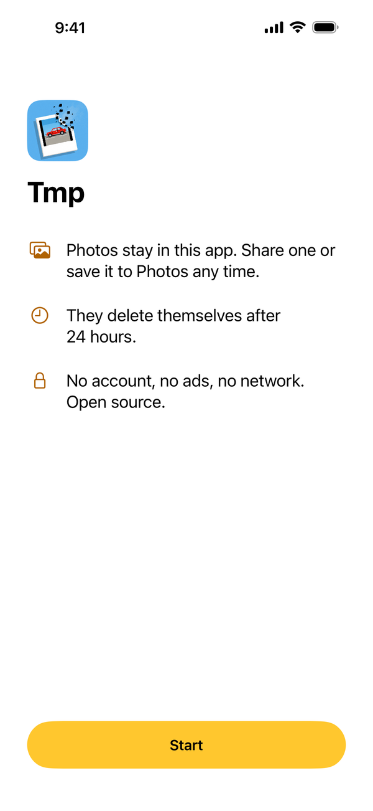
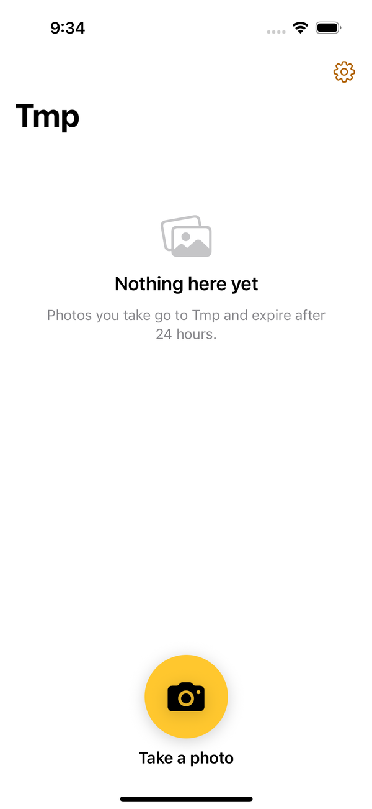
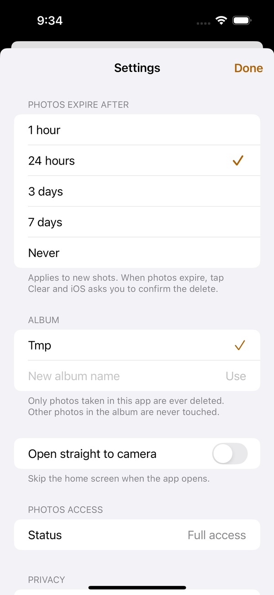

<div align="center">


# Tmp Camera

A camera for photos you only need for a day. Open source, no network code.

[](https://github.com/NelsonScott/tmp-pics/actions/workflows/tests.yml)
[](LICENSE)

  

</div>

A camera for photos you only need for a little while: where you parked, a printer test page, a label, a
receipt you will type in later. Shots go into an album called Tmp and expire after 24 hours (or a time you
choose).

Apps like this already exist. I wrote this one because I did not want to hand my photo library to an app
from a developer I knew nothing about, some with ads and trackers. So here, you can see all the source
code. Small, no network code, and you can check everything yourself.

## How it works

- The first time, one screen explains the app. After that it opens to your current shots, with the time
  left on each, and a big camera button.
- The camera stays open so you can take a few shots. Done takes you back.
- Tap a shot to share it, keep it (it stops expiring and stays in Photos) or delete it now.
- Settings: how long shots last (1 hour to 7 days, or never), which album, and "Open straight to camera"
  if you want to skip the home screen.
- Photos are saved at the largest size the camera offers.

The app can't delete photos on its own: iOS asks you to confirm every delete. That is why shots go in an
album called Tmp, so they are always easy to find and clear. When you open the app and something has
expired, it offers to clear it. It only ever deletes photos it took itself.

## Privacy

No ads, no account, no analytics, no network code. It is open source, so you can read all of it.

## Build it yourself

Needs iOS 17 or later, iPhone only. You need a Mac with Xcode and [xcodegen](https://github.com/yonaskolb/XcodeGen) (`brew install xcodegen`).

```sh
git clone https://github.com/NelsonScott/tmp-pics.git
cd tmp-pics/ios
```

Open `Config/App.xcconfig` and change `APP_BUNDLE_ID` to one of your own, like `com.yourname.tmp`. The
current one belongs to my developer account, so Xcode can't sign it for you. Then:

```sh
xcodegen generate
open TmpCamera.xcodeproj
```

In Xcode, pick your team under Signing & Capabilities, choose your iPhone and press Run.

## Tests

Unit tests cover the expiry and tracking logic and the camera maths. They run on every push with GitHub
Actions. To run them yourself: `xcodebuild test -project TmpCamera.xcodeproj -scheme TmpCamera
-only-testing:TmpCameraTests -destination 'platform=iOS Simulator,name=iPhone 16'` from `ios/`.

## Licence

MIT. See [LICENSE](LICENSE).
